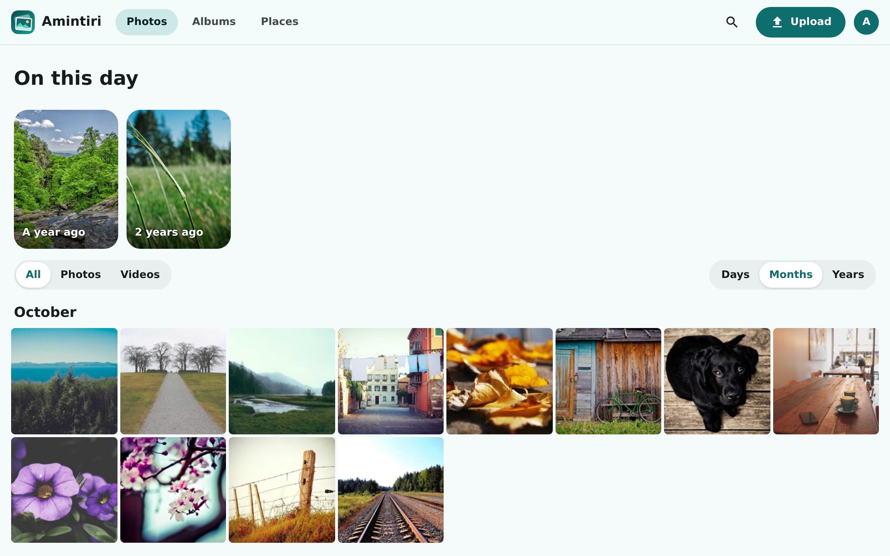
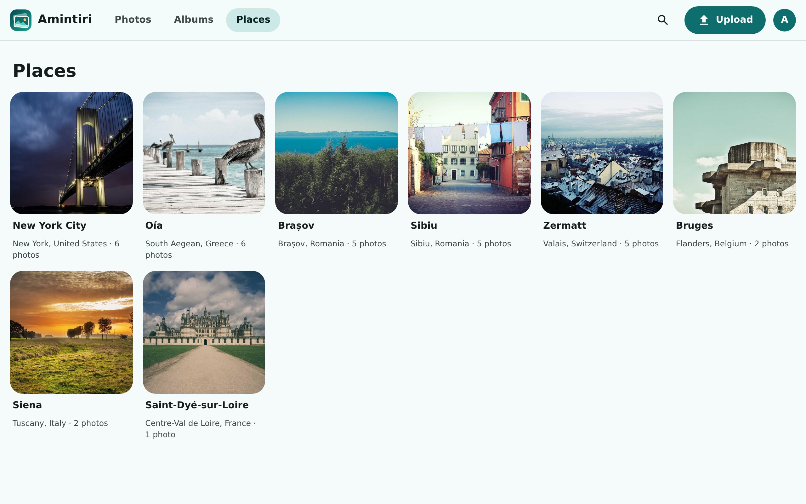
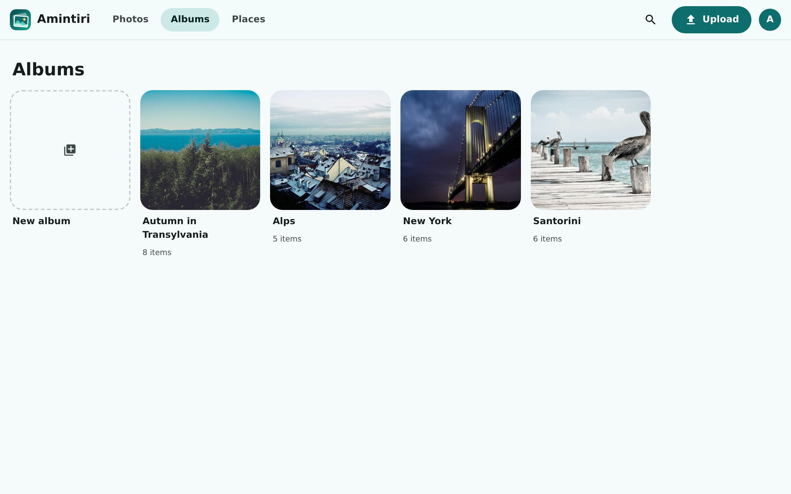
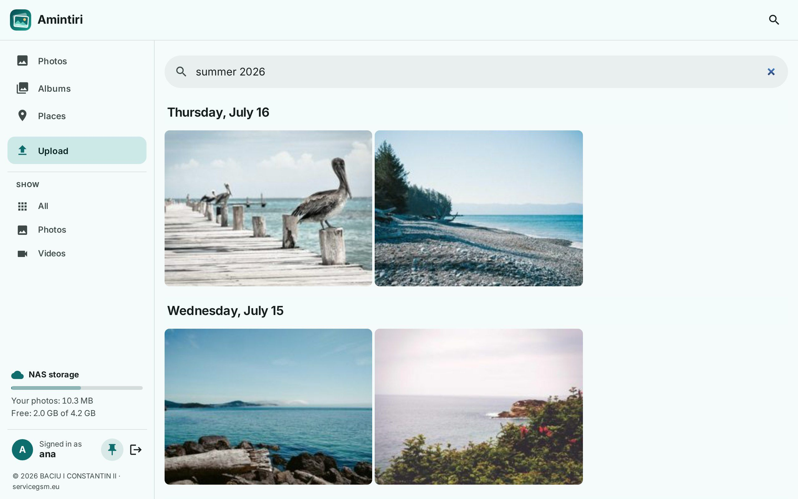
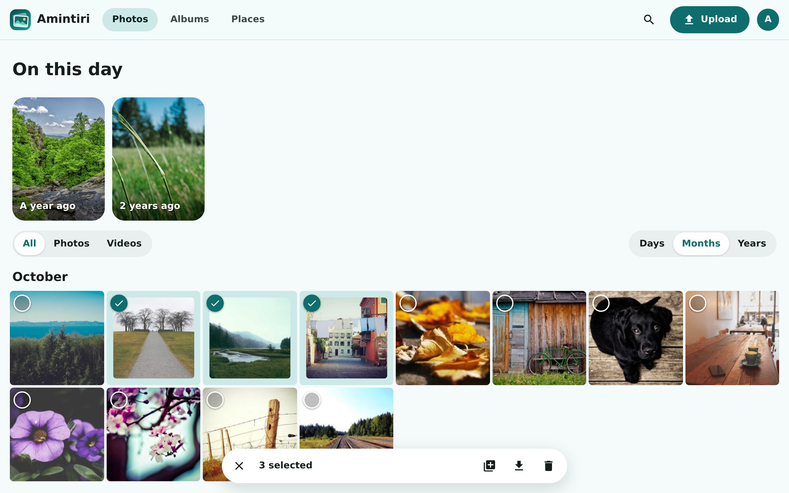
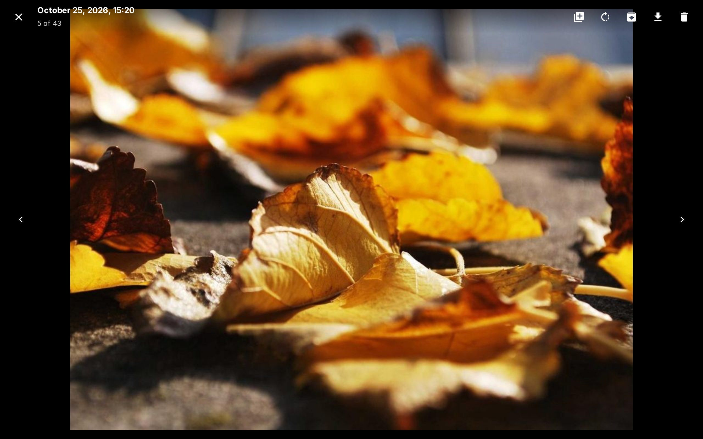
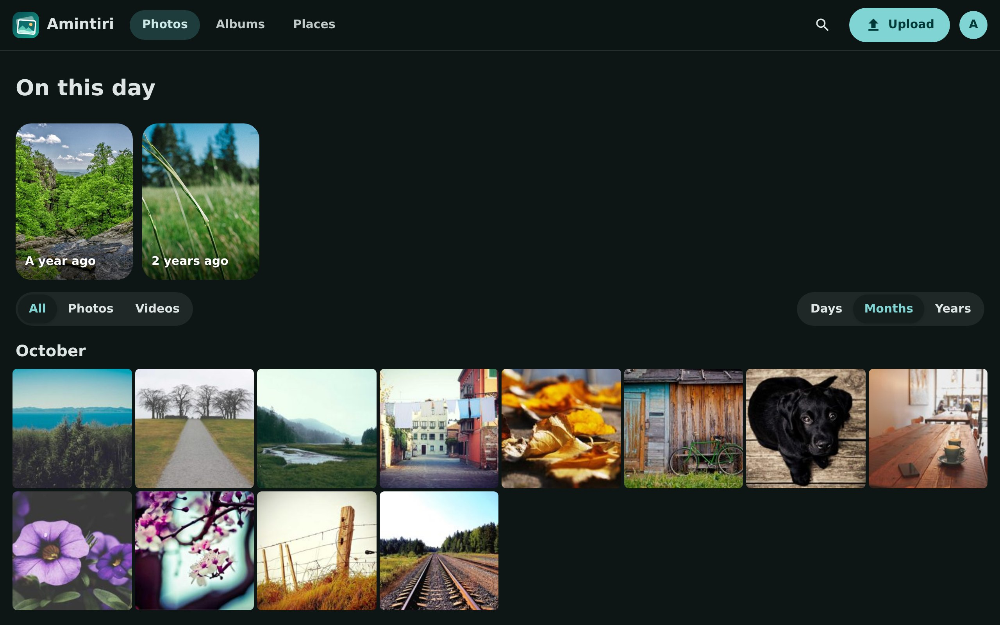
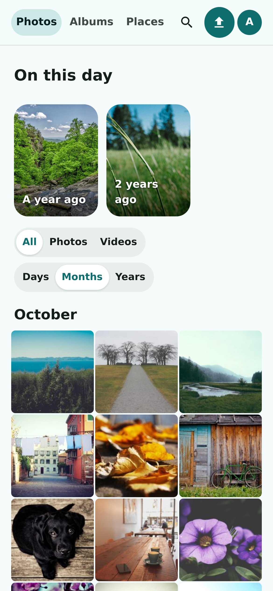
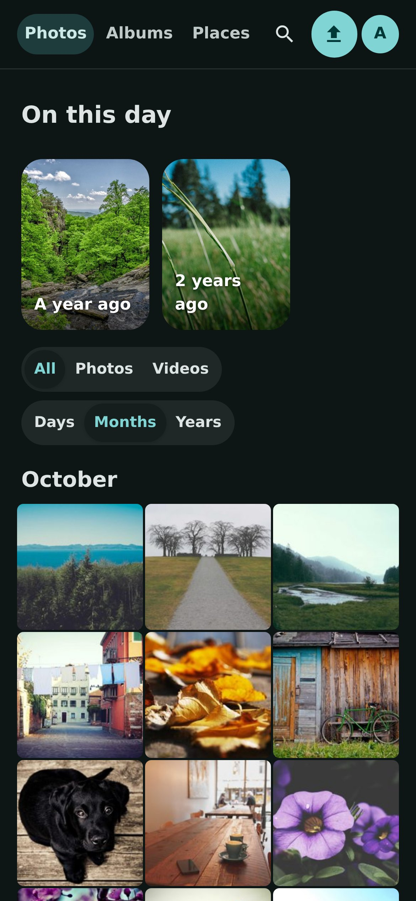
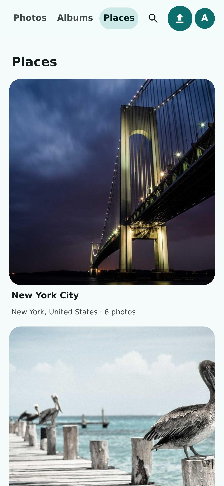

# Amintiri

A lightweight photo server for **Synology NAS**, with an Android app — an alternative to Synology Photos
that keeps your pictures as plain files in your own `Photos` folder.

- **Uses your DSM accounts.** People sign in with their NAS user name and password (2-step verification
  supported). No second user database.
- **Your files stay yours.** Photos go to `homes/<user>/Photos/<year>/<month>/`, named by the date they
  were taken. Stop using Amintiri tomorrow and nothing is locked in.
- **Light.** One small container (Python + SQLite); runs fine on ARM models.
- **Android app:** automatic backup (Wi-Fi or mobile data), timeline by day / month / year, albums,
  places, "on this day" memories, search ("summer 2024", "august", a city), favourites,
  30-day trash, free-up-space, share links for albums, fingerprint lock.
- **Web app** in the browser: the same timeline, upload, albums, multi-select, search.

  

| | | |
|---|---|---|
|  |  |  |
| **Places**, from the photos' GPS — offline, nothing leaves the NAS | **Albums**, shareable by link | **Search**: “summer 2026”, “August”, a city |
|  |  |  |
| Select many, add to an album, download or delete | Full-screen viewer | Follows the system's dark theme |

  
  
  

Sample photos from <a href="https://unsplash.com">Unsplash</a> via <a href="https://picsum.photos">Lorem Picsum</a>.

> The interface is in **Romanian and English** (follows the phone or browser; can be changed in Settings).

## Requirements

- Synology DSM 7 with **Container Manager**
- **User Home service** on (Control Panel → User & Group → Advanced → Enable user home service)
- Each person needs **DSM: Allow** (Control Panel → User & Group → the user → Applications)
- A domain name with HTTPS (DSM reverse proxy + certificate; Cloudflare works)

## Install

1. In File Station create a folder, e.g. `/docker/amintiri`, and **inside it a folder named `data`**
   (Container Manager does not create missing folders: without `data` the container won't start —
   *Bind mount failed: … does not exist*).
2. Container Manager → **Project → Create** → path: that folder → *Create docker-compose.yml* →
   paste [`docker-compose.yml`](docker-compose.yml) → adjust `TZ` if needed → **Done**.
3. Control Panel → Login Portal → Advanced → **Reverse Proxy → Create**:
   HTTPS `photos.example.com` 443 → HTTP `localhost` **8090**.
4. Open `https://photos.example.com` in a browser and sign in with your DSM account.
5. Install the **Android app** from the [Releases](../../releases) page (`amintiri-*.apk`),
   enter `photos.example.com` as the server and sign in.

Updating: Container Manager → Project → amintiri → **Action → Build** (pulls the latest image),
or `docker compose pull && docker compose up -d`.

### Firewall

If the DSM firewall blocks by country and you use Cloudflare, allow the
[Cloudflare IP ranges](https://www.cloudflare.com/ips-v4) on ports 80/443 above the deny rule —
otherwise some visitors get error 522.

## How it works

- Sign-in is checked against DSM (`SYNO.API.Auth` on `127.0.0.1:5000`); the server never stores passwords.
- The server indexes each user's `Photos` folder (photos and videos already there show up too),
  makes thumbnails and keeps albums, favourites and the trash in `data/poze.db`.
- A copy of the database is written every day to `data/backup/` (last 7 kept).
- Uploads are resumable (8 MB chunks) and de-duplicated by SHA-256.

## Data and privacy

Everything stays on your NAS. The app talks only to your server and, to check for app updates,
to GitHub. There is no analytics and no account with us.

## Licence

Copyright © 2026 BACIU I CONSTANTIN II ([servicegsm.eu](https://servicegsm.eu)).
Contact: office@servicegsm.eu

The server is released under the **GNU AGPL-3.0** ([LICENSE](LICENSE)).
The Android app is distributed as a signed APK on the Releases page; its source is not published.
