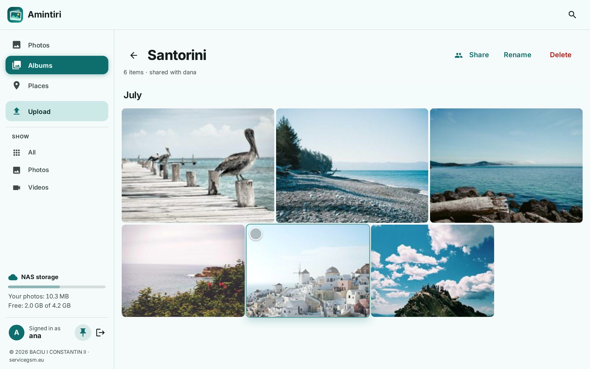
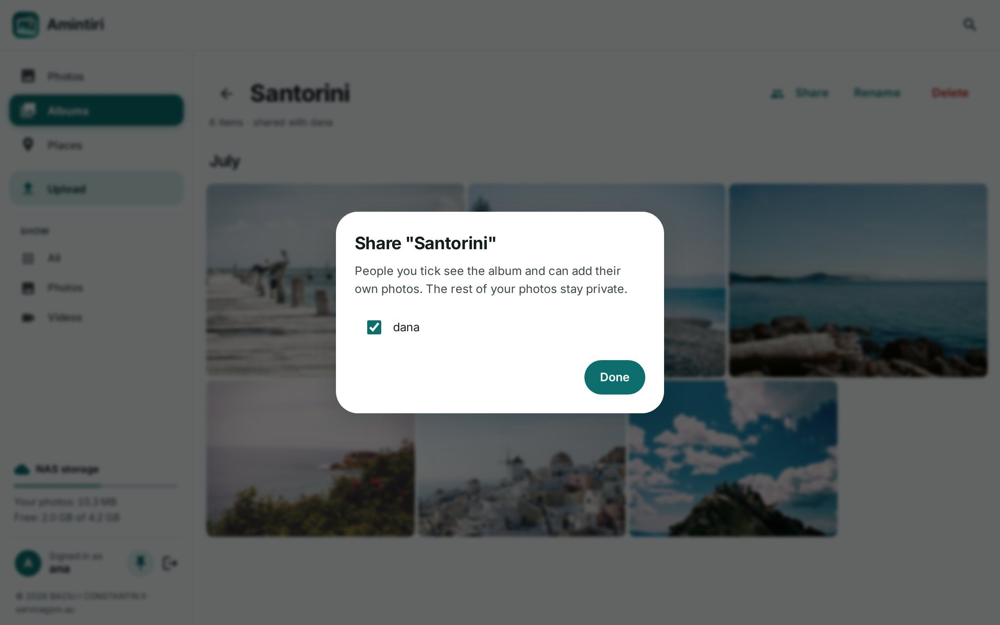
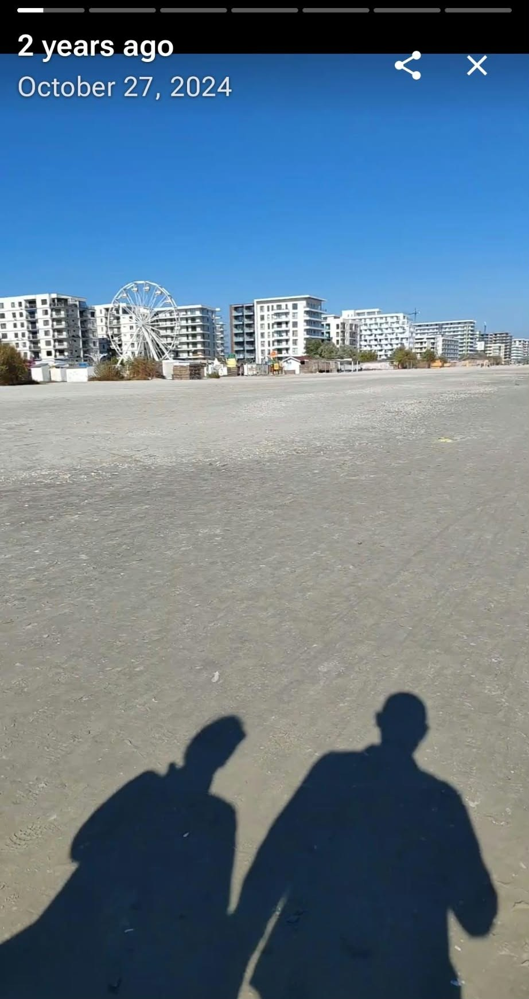
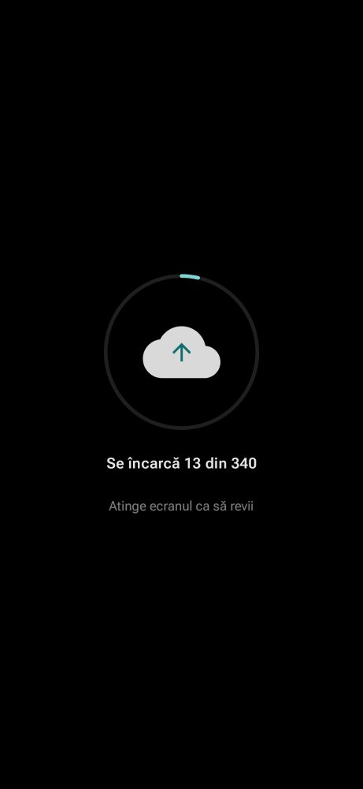

# Amintiri

A lightweight photo server for **Synology NAS**, with an Android app: Google Photos–style backup,
memories and sharing for your family, while your pictures stay plain files in your own `Photos` folder.

  

## What it does

**Backup from the phone**
- Automatic backup of the folders you choose, in the background and as soon as you take a photo;
  on Wi-Fi only or on mobile data too, optionally only while charging.
- **Fast at home:** on your home Wi-Fi the phone uploads straight to the NAS, not through the internet
  and Cloudflare — on our network 1 → 8 MB/s, see [Backup at home](#backup-at-home).
- **You know it works:** a notification if photos haven't been backed up for over a day, with the likely
  reason; the screen can stay on during a big first backup and dims itself to a quiet progress view.
- Free up space: delete from the phone what is already safe on the NAS.

**Browsing**
- Timeline by day / month / year, with a year scrubber on the web.
- **Memories:** "on this day" from past years at the top, full-screen stories on the phone and a
  morning notification.
- **Places** from the photos' GPS, worked out offline on the NAS; **search** for "summer 2024",
  "August", a city or an album name.
- Favourites, rotate (your original file is never rewritten), **archive** (hide photos from the
  timeline and memories; they stay in albums and search), 30-day trash.

**Sharing**
- **Shared family albums:** share an album with other NAS accounts; everyone sees it and adds their own
  photos, while the rest of each person's library stays private.
- Public links for an album, for people without an account; turn them off any time.

**Your NAS, your rules**
- Sign in with your **DSM accounts** (2-step verification supported). No second user database.
- Photos are saved to `homes/<user>/Photos/<year>/<month>/`, named by the date they were taken.
  Stop using Amintiri tomorrow and nothing is locked in.
- **Light:** one small process (Python + SQLite, ~70 MB RAM), installed from **Package Center** or as a
  container; runs on ARM j-series models too.
- Android app with fingerprint lock, and a web app in any browser.
- **Bring your Google Photos library:** import a Google Takeout export with dates, places, albums and
  favourites, without duplicating what your phone already backed up. See
  [Import from Google Photos](#import-from-google-photos).

## Screenshots

| | | |
|---|---|---|
|  |  |  |
| **Albums**, with Archive and shared albums | A **shared album**: everyone adds their own photos | **Share** with the people on your NAS |
|  |  |  |
| **Places**, from the photos' GPS — offline | **Search**: “summer 2026”, “August”, a city | Select many: album, archive, download, delete |
|  |  | |
| Viewer: rotate, archive, add to an album | Follows the system's dark theme | |

  
  
  
  
  

Android app: a memory and the quiet upload screen. The others: the web app on a phone.

Sample photos from <a href="https://unsplash.com">Unsplash</a> via <a href="https://picsum.photos">Lorem Picsum</a>; the memory is the author's own.

> The interface is in **Romanian and English** (follows the phone or browser; can be changed in Settings).

## Requirements

- Synology **DSM 7.2** or newer
- **User Home service** on (Control Panel → User & Group → Advanced → Enable user home service)
- Each person needs **DSM: Allow** (Control Panel → User & Group → the user → Applications)
- For use away from home: a domain name with HTTPS (DSM reverse proxy + certificate; Cloudflare works)

## Install from Package Center (recommended)

No Container Manager needed, so it also works on the j-series and other ARM models.

1. Download the package for your NAS from the latest server release on the [Releases](../../releases) page:
   - `amintiri-<version>-x86_64.spk`: Intel/AMD models (most “+” models: DS224+, DS423+, DS923+, …)
   - `amintiri-<version>-armv8.spk`: 64-bit ARM (DS223j, DS220j, DS120j, DS223, DS218, …) — **beta**, not yet
     tested on real hardware; please report how it goes.

   Not sure which? Control Panel → Info Center → General → *CPU*, then Synology's
   [CPU list](https://kb.synology.com/en-global/DSM/tutorial/What_kind_of_CPU_does_my_NAS_have).
2. Package Center → Settings → General → Trust Level: **Any publisher** (the package isn't signed by Synology).
3. Package Center → **Manual Install** → choose the file. The wizard asks for:
   - **Port** (default 8090);
   - **Web address** (optional, see step 4);
   - **Time zone** for photos whose camera didn't record one.

   DSM then asks to give Amintiri Read/Write on the `homes` shared folder: that's where everyone's photos are.
4. **At home** that's it: the Amintiri icon in the DSM main menu opens `http://<your NAS>:8090`.
   **Away from home** (and for phone backup outside your Wi-Fi), add Control Panel → Login Portal → Advanced →
   **Reverse Proxy → Create**: HTTPS `photos.example.com` 443 → HTTP `localhost` 8090, and enter
   `photos.example.com` as the web address when you install or update.
5. Install the **Android app** from the [Releases](../../releases) page (`amintiri-*.apk`), enter your address and
   sign in with your DSM account.

Updating: when a new version is out, NAS administrators see it in the web app (with a **Download** button
for the right package) and under Settings → About in the Android app. Run Manual Install with the new `.spk`;
your settings and albums are kept.

The package runs under its own account, not as root. Photos it saves belong to that account, and each person
reaches them through their home folder's permissions, as with any file in it. If a home folder's permissions
were changed by hand and don't pass down to `Photos` any more, give the `amintiri` user Read/Write on that
`Photos` folder in File Station.

## Install with Container Manager

1. In File Station create a folder, e.g. `/docker/amintiri`, and **inside it a folder named `data`**
   (Container Manager does not create missing folders: without `data` the container won't start —
   *Bind mount failed: … does not exist*).
2. Container Manager → **Project → Create** → path: that folder → *Create docker-compose.yml* →
   paste [`docker-compose.yml`](docker-compose.yml) → adjust `TZ` if needed → **Done**.
3. Control Panel → Login Portal → Advanced → **Reverse Proxy → Create**:
   HTTPS `photos.example.com` 443 → HTTP `localhost` **8090**.
4. Open `https://photos.example.com` in a browser and sign in with your DSM account.
5. Install the **Android app** from the [Releases](../../releases) page (`amintiri-*.apk`),
   enter `photos.example.com` as the server and sign in.

Updating: Container Manager → Project → amintiri → **Action → Build** (pulls the latest image),
or `docker compose pull && docker compose up -d`.

### Firewall

If the DSM firewall blocks by country and you use Cloudflare, allow the
[Cloudflare IP ranges](https://www.cloudflare.com/ips-v4) on ports 80/443 above the deny rule —
otherwise some visitors get error 522.

## Backup at home

Away from home the phone uploads through your domain (`https://photos.example.com`). At home that same
path goes out to the internet and back — through Cloudflare, if you use it — which caps uploads at
roughly the speed of your internet upload, often 1 MB/s.

With the Package Center install, or `POZE_HOST: 0.0.0.0` (the default in [`docker-compose.yml`](docker-compose.yml)),
the app notices it
is on the same Wi-Fi as the NAS and sends photos **directly to the NAS's local address**
(`http://192.168.x.x:8090`). On our network that took a phone from about 1 MB/s to 8 MB/s; the first
backup of a full phone goes from days to hours. Nothing to set up in the app: it decides on its own,
before every backup, and falls back to the domain as soon as you leave home.

How it stays safe:

- **The phone checks it's really your NAS** before sending the sign-in token to a local address: the NAS
  must answer a one-time challenge with a key only it and your account know. A different device that
  happens to have the same address on another Wi-Fi gets nothing.
- **The local port answers only devices on your network** (private addresses: 192.168.x.x, 10.x.x.x,
  172.16–31.x.x). There the web app works too, over plain http like DSM's own port 5000; away from home
  it's only on the HTTPS domain.
- The DSM firewall must allow your home network on port **8090** (e.g. *Allow — 192.168.0.0/24 — all ports*).
  **Do not forward port 8090 on your router.**

To turn it off in the container, set `POZE_HOST: 127.0.0.1`; everything then goes through the domain.

## Import from Google Photos

Google doesn't let apps read your whole library, so the import goes through Google Takeout. The web page
(account menu → Import from Google Photos) walks you through it:

1. At [takeout.google.com](https://takeout.google.com), select only Google Photos and export once as .zip
   (50 GB parts mean fewer files).
2. When Google emails the links, download every part.
3. Copy the archives, still zipped, to the `Import Google` folder in your home folder on the NAS
   (Amintiri creates it the first time you open the import page). An unpacked `Takeout` folder works too.
4. Press **Import**. It runs in the background and shows its progress.

Amintiri reads the date and the location from the `.json` files next to each photo, even when they are in
another part of the archive or their names are cut short. Photos that are in an album and in
"Photos from 2019" are kept once, as are photos already backed up from your phone. That includes the
smaller copies Google keeps with "Storage saver": a copy taken in the same second, with the same shape, the
same camera and the same picture as a phone original already on the NAS is skipped, and the original
stays. Albums, favourites and archived photos come across, and photos from Google's bin are skipped. Photos you delete later are not
brought back by another run. The archives are only read. The report tells you when it is safe to delete
them: not while some file is left out (a type Amintiri doesn't know yet, a half-downloaded part, a full
disk). An interrupted import carries on where it stopped.

## How it works

- Sign-in is checked against DSM (`SYNO.API.Auth` on `127.0.0.1:5000`); the server never stores passwords.
- The server indexes each user's `Photos` folder (photos and videos already there show up too),
  makes thumbnails and keeps albums, favourites and the trash in `data/poze.db` (for the package:
  `/var/packages/amintiri/var/data/`, readable only by the package).
- A copy of the database is written every day to `data/backup/` (last 7 kept).
- Uploads are resumable (8 MB chunks) and de-duplicated by SHA-256.
- Rotation is stored in the database and applied to thumbnails; downloads give you the original file.
- Shared albums only reference photos: each photo stays in its owner's folder, and leaving an album
  takes your photos out of it.

## How it's built

Amintiri is developed with heavy AI assistance (Claude). The ideas, the decisions and the testing are
mine: it runs every day on my own Synology NAS and Android phone with my family's photos, and each
change goes to a test instance before it reaches mine. The server has an automated test suite
(`pytest`, 200+ tests) and the code is here to read — if something looks wrong, please open an issue.

## Data and privacy

Everything stays on your NAS. The app talks only to your server and, to check for app updates,
to GitHub; the server asks GitHub for the latest release at most every 6 hours, only when a NAS
administrator is signed in. There is no analytics and no account with us.

## Licence

Copyright © 2026 BACIU I CONSTANTIN II ([servicegsm.eu](https://servicegsm.eu)).
Contact: office@servicegsm.eu

The server is released under the **GNU AGPL-3.0** ([LICENSE](LICENSE)).
The Android app is distributed as a signed APK on the Releases page; its source is not published.
